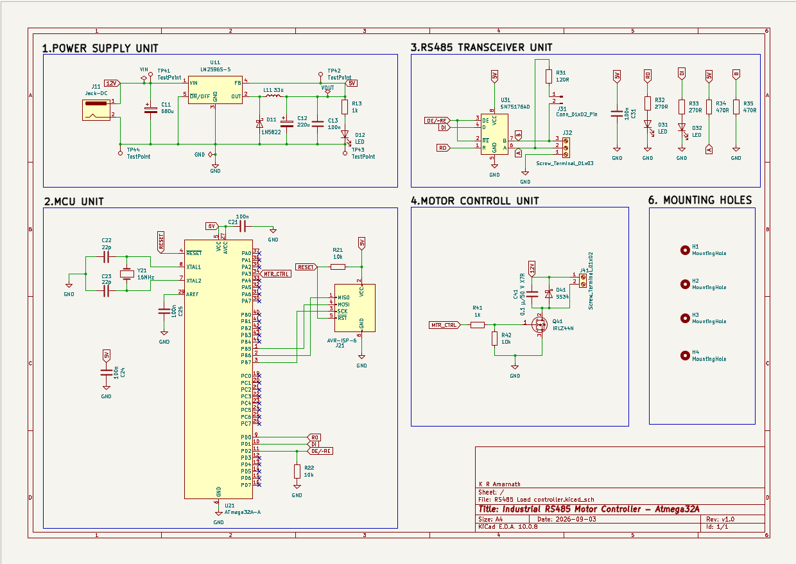
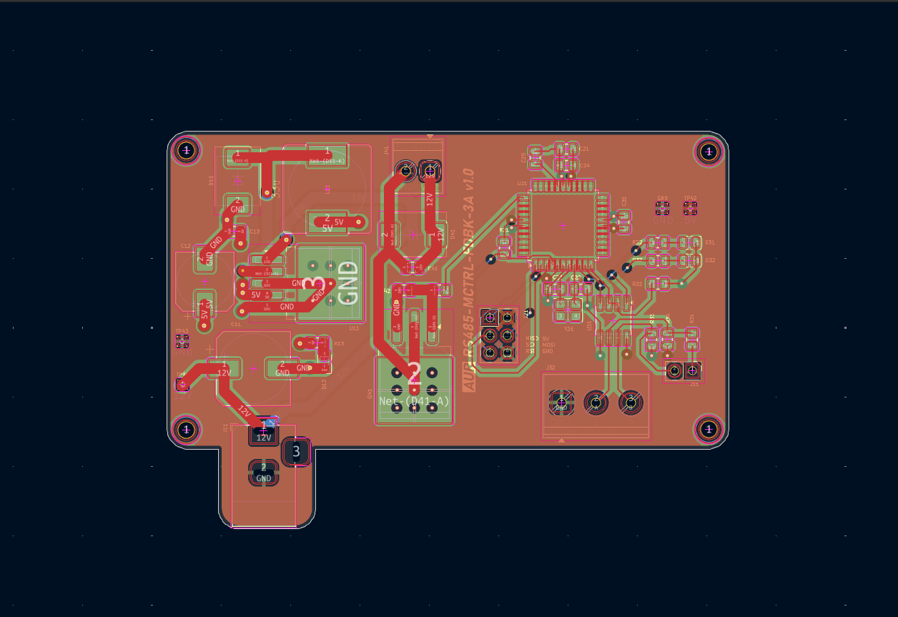
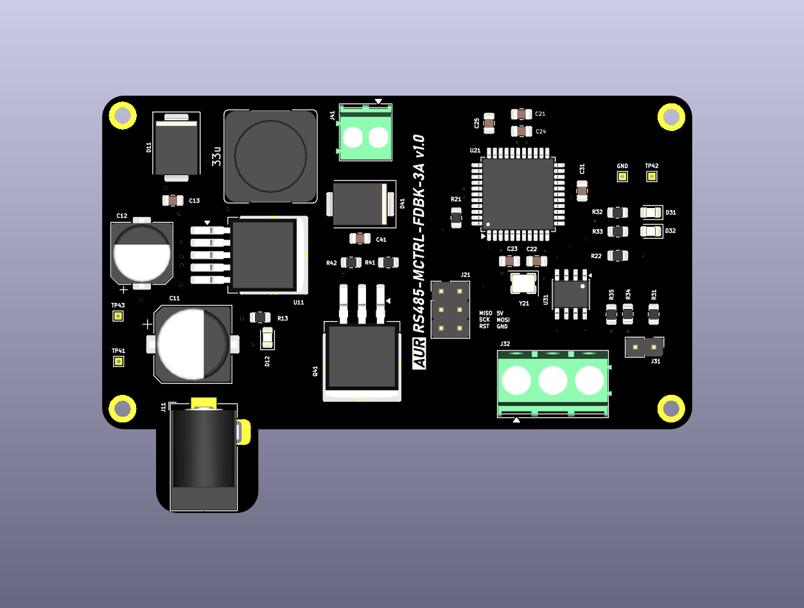
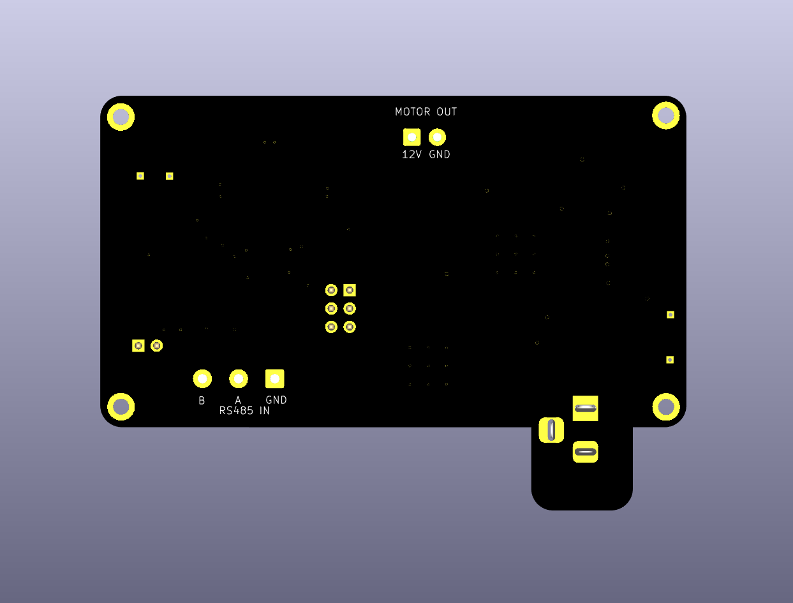

# RS-485 Motor Controller - Atmega32A

## Table of Contents
1. [Description](#1-description)
2. [Repository Structure](#2-repository-structure)
3. [Features](#3-features)
4. [Specifications](#4-specifications)
5. [Simple Working Explanation](#5-simple-working-explanation)
6. [How to Use and Flashing the Firmware](#6-how-to-use-and-flashing-the-firmware)
7. [PCB Images](#7-pcb-images)
8. [BoM Table](#8-bom-table)
9. [License](#9-license)

---

## 1. Description
A compact, 4-layer PCB designed for reliable remote ON/OFF switching of a 12V DC load (such as a DC motor, solenoid, valve, or high-current lamp) upto 3A over an industrial **RS-485** serial bus. Built around an **ATmega32A** microcontroller and an **SN75176AD** half-duplex RS-485 transceiver, the board integrates an onboard **LM2596S-5** step-down converter for 5V logic power and an **IRLZ44N** logic-level N-channel MOSFET with flyback protection for inductive and resistive loads.

---

## 2. Repository Structure
```text       
├── Docs/
│   └── images                  # Schematic captures, PCB layout AND 3d
├── README.md                   # Project documentation
└── LICENSE
```

---

## 3. Features
- **Industrial RS-485 Communication:** Half-duplex differential bus (`A`, `B`, `GND`) via `SN75176AD` with failsafe biasing resistors (`R34`, `R35`), selectable `120 Ω` bus termination (`J31` + `R31`), and TX/RX status LEDs (`D31`, `D32`).
- **Onboard 12V-to-5V Buck Regulation:** High-efficiency `LM2596S-5` switching regulator (`U11`) powers the microcontroller and transceiver directly from the main 12V input rail.
- **High-Current Low-Side Switching:** Logic-level `IRLZ44N` MOSFET (`Q41`) with `SS34` Schottky flyback diode (`D41`) to safely switch inductive DC loads.
- **AVR Microcontroller Core:** `ATmega32A-A` (`TQFP-44`) running at `16 MHz` (`Y21`) with a standard 6-pin AVR ISP header (`J21`) for easy firmware programming.
- **4-Layer PCB Stackup:** Designed on a 4-layer board (`F.Cu`, `In1.Cu`, `In2.Cu`, `B.Cu`) with mounting holes (`H1`–`H4`) and test points (`TP41`–`TP44`) for convenient debugging and enclosure mounting.

---

## 4. Specifications

| Parameter | Specification |
| :--- | :--- |
| **Input Supply Voltage** | `12V DC` (via 2-pin screw terminal `J11`) |
| **Logic Supply Voltage** | `5V DC` regulated (via `LM2596S-5`) |
| **Microcontroller** | `ATmega32A-A` (8-bit AVR, `16 MHz` external crystal) |
| **Communication Interface** | Half-duplex RS-485 (`SN75176AD`, 3-pin terminal `J32`) |
| **Bus Termination** | Selectable `120 Ω` via jumper `J31` |
| **Output Stage** | Low-side N-Channel MOSFET (`IRLZ44N`) + `SS34` flyback diode |
| **Load Connector** | 2-pin screw terminal (`J41`) |
| **Programming Interface** | Standard 2x3 AVR ISP header (`J21`) |
| **PCB Stackup & Dimensions** | 4-Layer FR-4, approx. `75 mm × 40 mm` |

---

## 5. Simple Working Explanation
1. **Power Supply Stage:** `12V DC` enters through terminal `J11` (filtered by bulk capacitor `C12`). The `LM2596S-5` buck converter (`U11`), inductor `L11` (`33 µH`), catch diode `D11` (`1N5822`), and output capacitor `C11` (`680 µF`) step the voltage down to a stable `5V` rail indicated by power LED `D12`.
2. **RS-485 Communication Stage:** Differential signals on lines `A` and `B` (`J32`) are converted to TTL UART levels (`PD0`/`RXD` and `PD1`/`TXD`) by the `SN75176AD` transceiver (`U31`). Direction control (`DE/~RE`) is managed by the ATmega32A with a `10 kΩ` pull-down (`R22`) to keep the transceiver safely in receive mode during reset.
3. **Control & Load Switching Stage:** When the `ATmega32A` (`U21`) receives a valid ON/OFF command for its address, it drives pin `PA3` (`MTR_CTRL`) high or low. This switches the `IRLZ44N` MOSFET (`Q41`) through gate resistor `R41` (`1 kΩ`) and pull-down `R42` (`10 kΩ`), connecting the load's negative terminal (`J41`) to `GND` while `D41` (`SS34`) clamps inductive voltage spikes.

---

## 6. How to Use and Flashing the Firmware

### Wiring & Hardware Setup
1. **Power (`J11`):** Connect a `12V DC` power supply to `J11` (`12V` and `GND`). Confirm the `5V` power LED (`D12`) turns on.
2. **Load (`J41`):** Connect your 12V DC load between `J41` pin 1 (`12V` / `LOAD+`) and pin 2 (`LOAD-` / switched drain).
3. **RS-485 Bus (`J32`):** Connect `A`, `B`, and `GND` to your RS-485 master/controller.
4. **Termination (`J31`):** Install a jumper across `J31` **only** if this board is at the physical end of the RS-485 bus.

### Flashing the Firmware (via AVR ISP)
1. Connect a standard 6-pin AVR programmer (such as **USBasp**, **AVRISP mkII**, or **Arduino as ISP**) to header `J21` (`MISO`, `VCC`, `SCK`, `MOSI`, `RESET`, `GND`).
2. Set the fuses for an external `16 MHz` crystal oscillator (`Low Fuse: 0xFF`, `High Fuse: 0xD9`) and flash the compiled `.hex` file using `avrdude`:

```bash
# 1. Set fuses for 16 MHz external crystal
avrdude -c usbasp -p m32 -U lfuse:w:0xff:m -U hfuse:w:0xd9:m

# 2. Flash firmware binary
avrdude -c usbasp -p m32 -U flash:w:Firmware/hex/firmware.hex:i
```

---

## 7. PCB Images

### Schematic

<div align="center">
  <table>
    <tr>
      <td align="center">
        <br>
        <b>Schematic 1</b>
      </td>
    </tr>
  </table>
</div>

### Copper Layers

<div align="center">
  <table>
    <tr>
      <td align="center">
        <br>
        <b>Layout</b>
      </td>
    </tr>
  </table>
</div>

### 3D Model

<div align="center">
  <table>
    <tr>
      <td align="center">
        <br>
        <b>PCB 3D Image-1</b>
      </td>
      <td align="center">
        <br>
        <b>PCB 3D Image-2</b>
      </td>
    </tr>
  </table>
</div>

---

## 8. BoM Table

| Item | Qty | Reference(s) | Value |
| :--- | :---: | :--- | :--- |
| 1 | 1 | `C11` | `680u` |
| 2 | 1 | `C12` | `220u` |
| 3 | 3 | `C21, C24, C31` | `100n` |
| 4 | 2 | `C22, C23` | `22p` |
| 5 | 1 | `C41` | `0.1u/50V X7R` |
| 6 | 1 | `D11` | `1N5822` |
| 7 | 3 | `D12, D31, D32` | `LED` |
| 8 | 1 | `D41` | `SS34` |
| 9 | 4 | `H1, H2, H3, H4` | `MountingHole_Pad` |
| 10 | 2 | `J11, J41` | `Screw_Terminal_01x02` |
| 11 | 1 | `J21` | `AVR-ISP-6` |
| 12 | 1 | `J31` | `Conn_01x02_Pin` |
| 13 | 1 | `J32` | `Screw_Terminal_01x03` |
| 14 | 1 | `L11` | `33u` |
| 15 | 1 | `Q41` | `IRLZ44N` |
| 16 | 1 | `R11` | `2k` |
| 17 | 3 | `R21, R22, R42` | `10k` |
| 18 | 1 | `R31` | `120R` |
| 19 | 2 | `R32, R33` | `270R` |
| 20 | 2 | `R34, R35` | `470R` |
| 21 | 1 | `R41` | `1k` |
| 22 | 4 | `TP41, TP42, TP43, TP44` | `TestPoint` |
| 23 | 1 | `U11` | `LM2596S-5` |
| 24 | 1 | `U21` | `ATmega32A-A` |
| 25 | 1 | `U31` | `SN75176AD` |
| 26 | 1 | `Y21` | `16MHz` |

---

## 9. License
This project is open-source hardware/software licensed under the **MIT License** (or **CERN-OHL-P v2** for hardware). See the [LICENSE](LICENSE) file for full details.
